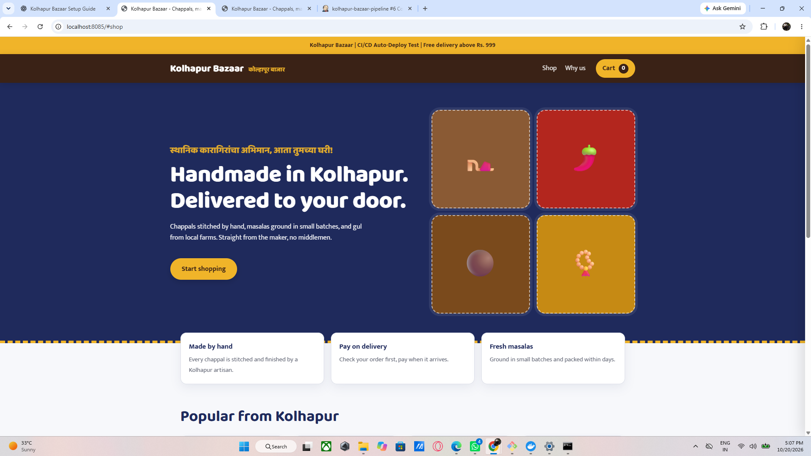
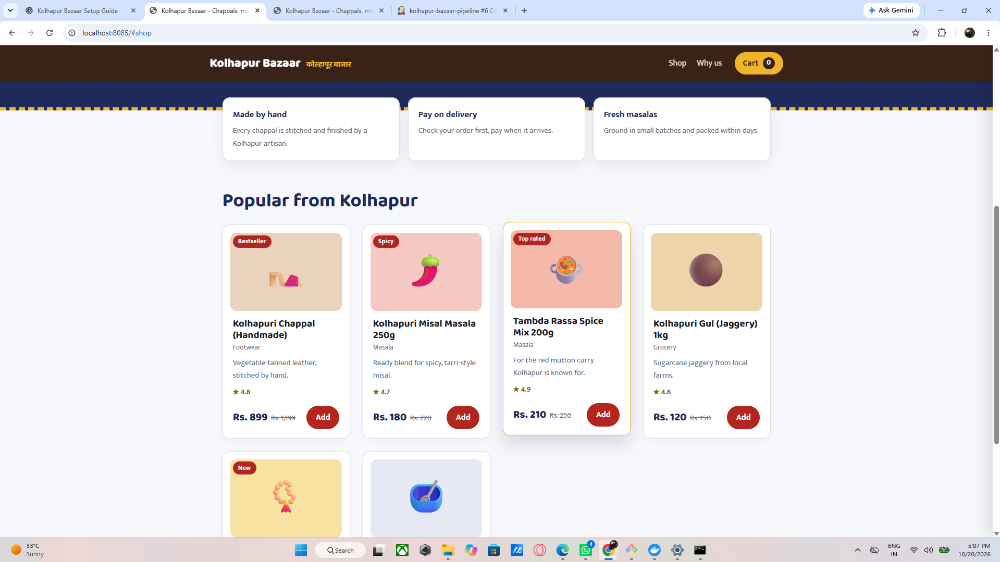
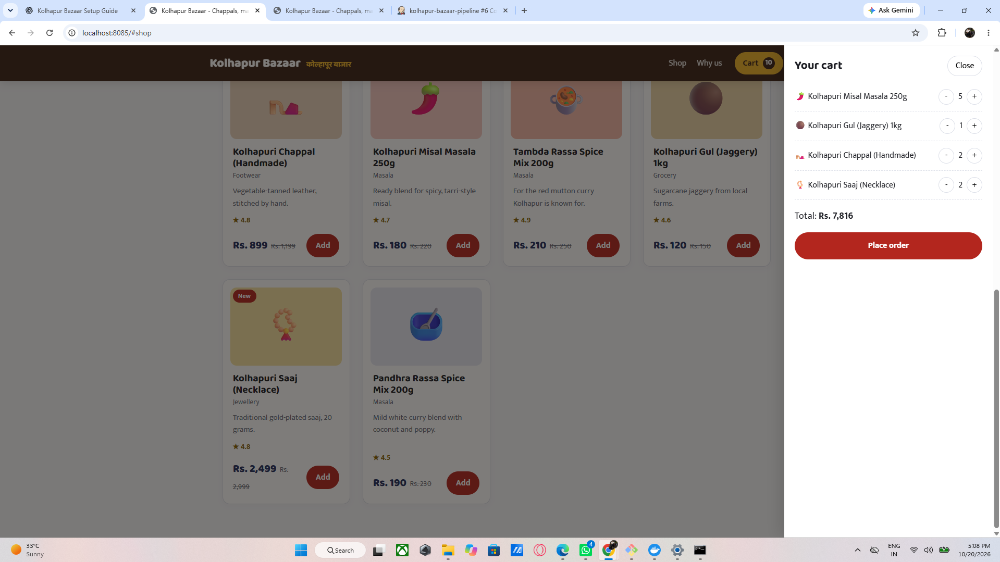
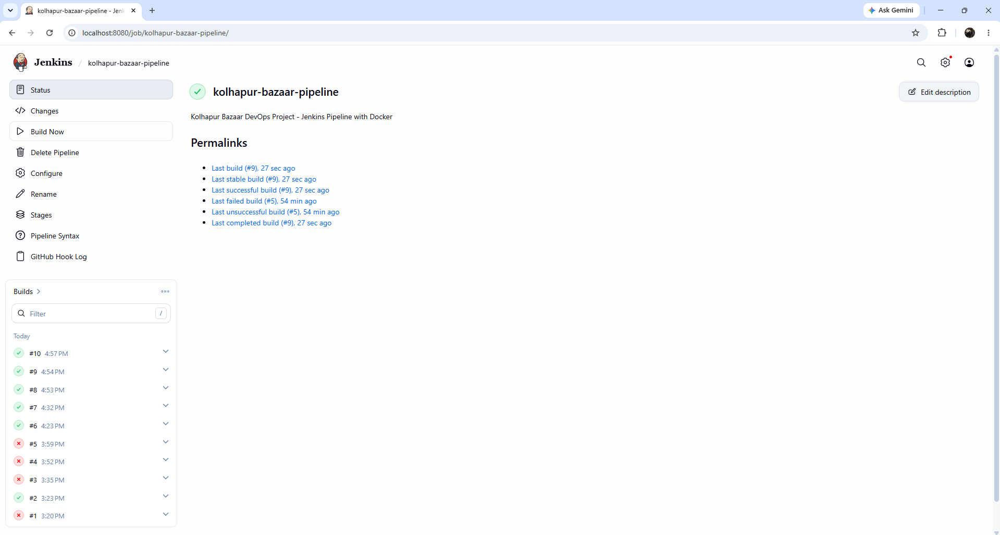
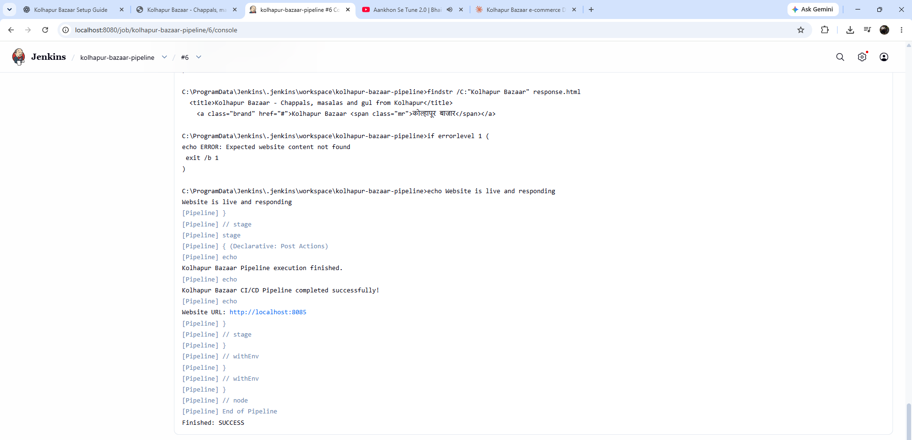

<div align="center">

# 🛍️ Kolhapur Bazaar

### *स्थानिक कारागिरांचा अभिमान, आता तुमच्या घरी!*

An e-commerce website for the best of Kolhapur — **chappals, masala blends, jaggery & jewellery** — built, containerised and deployed with a **Git → GitHub → Jenkins → Docker** pipeline.


[🔗 **GitHub Repository**](https://github.com/MrLegendGS/Kolhapur-Bazaar) · [🚀 **Quick Start**](#-4-how-to-run) · [🖼️ **Screenshots**](#️-5-website-screenshots) · [⚙️ **Jenkins Pipeline**](#️-8-jenkins-integration)

</div>

---

## 👤 Student Details

| | |
|---|---|
| **Name** | Gaurav Sanjay Nikhare |
| **Roll Number** | 41 |
| **Division** | B |

---

## 📑 Table of Contents

1. [Introduction and Objective](#-1-introduction-and-objective)
2. [Technology Stack](#-2-technology-stack)
3. [Folder Structure](#-3-folder-structure)
4. [How to Run](#-4-how-to-run)
5. [Website Screenshots](#️-5-website-screenshots)
6. [Changes Made](#-6-changes-made-commits)
7. [Git and GitHub Workflow](#-7-git-and-github-workflow)
8. [Jenkins Integration](#️-8-jenkins-integration)

---

## 🎯 1. Introduction and Objective

**Kolhapur Bazaar** is an e-commerce website that sells products from Kolhapur:

- 👡 **Kolhapuri chappals**
- 🌶️ **Masala blends**
- 🍯 **Jaggery**
- 💍 **Jewellery**

**Objective:** build a working online store with a **cart and order flow**, manage the code with **Git/GitHub**, and automate **build, deploy and testing** with **Jenkins**.

### ✨ Features

- 🛒 Product grid with add-to-cart and quantity controls
- 💾 Cart persisted in `localStorage` (survives page refresh)
- 🧮 Validated cart items with protected total calculation
- 🪔 Marathi artisan tagline on the homepage
- 📱 Responsive and accessible styling
- 🐳 One-command Docker deployment
- 🤖 Automated Jenkins CI/CD pipeline with a smoke test

---

## 🧰 2. Technology Stack

| Layer | Tool |
|---|---|
| 🎨 Frontend | HTML5, CSS3, vanilla JavaScript (cart saved in localStorage) |
| 🌐 Web server | Nginx (inside Docker) |
| 🗂️ Version control | Git, GitHub |
| ⚙️ DevOps tool | Jenkins (declarative pipeline), Docker |

---

## 📁 3. Folder Structure

```
kolhapur-bazaar/
├── src/                 # website source (index.html, css/, js/)
├── docs/screenshots/    # proof images used in this README
├── Dockerfile           # builds the Nginx image
├── Jenkinsfile          # CI/CD pipeline
└── README.md
```

---

## 🚀 4. How to Run

### Without Docker
Open `src/index.html` in your browser. That's it!

### With Docker
```bash
docker build -t kolhapur-bazaar .
docker run -d -p 8085:80 --name kolhapur-bazaar kolhapur-bazaar
# open http://localhost:8085
```

> 💡 **Tip:** if the container name is already in use, run `docker rm -f kolhapur-bazaar` first.

---

## 🖼️ 5. Website Screenshots

### 🏠 Home Page
The home page displays Kolhapur Bazaar branding, product categories, and the main shopping section.



### 🧺 Product Listing
The "Popular from Kolhapur" section shows each product with its category, rating, discounted price and an **Add** button.



### 🛒 Shopping Cart
The shopping cart allows users to view selected products, change quantities, check the total amount, and proceed to place an order.



### 🚢 CI/CD Deployment
The website is built and deployed using a Jenkins pipeline and Docker container.



---

## 📝 6. Changes Made (Commits)

| # | Change | Commit |
|:-:|---|---|
| 1 | Initial project files uploaded | `Add files via upload` |
| 2 | Jenkins CI/CD pipeline improvements | `Refactor Jenkinsfile for improved CI/CD pipeline` |
| 3 | CI/CD deployment testing | `Test Jenkins CI/CD pipeline` |
| 4 | Added student details to README | `docs: add student details to README` |
| 5 | Documented website screenshots | `docs: document website and deployment screenshots` |
| 6 | Added Marathi tagline to homepage | `feat: add Marathi artisan tagline to homepage` |
| 7 | Improved responsive styling and accessibility | `feat: improve responsive styling and accessibility` |
| 8 | Fixed cart validation and total calculation | `fix: validate cart items and protect total calculation` |

---

## 🔀 7. Git and GitHub Workflow

```bash
git init
git add .
git commit -m "Initial commit: product grid and cart"
git branch -M main
git remote add origin https://github.com/MrLegendGS/Kolhapur-Bazaar.git
git push -u origin main

# for every change
git add .
git commit -m "feat: <what changed>"
git push

# view history
git log --oneline
```

### 🔗 Repository Link

**[MrLegendGS/Kolhapur-Bazaar — Kolhapur Bazaar: DevOps Project using Docker and Jenkins](https://github.com/MrLegendGS/Kolhapur-Bazaar)**

```
https://github.com/MrLegendGS/Kolhapur-Bazaar
```

---

## ⚙️ 8. Jenkins Integration

### Setup steps

1. Install Jenkins and the **Git**, **Pipeline** and **Docker Pipeline** plugins.
2. Make sure Jenkins can run Docker commands.
   *(On Linux: `sudo usermod -aG docker jenkins`, then restart Jenkins. On Windows, Docker Desktop must be running.)*
3. Create a new item, choose **Pipeline**, name it `kolhapur-bazaar-pipeline`.
4. Under Pipeline, select **Pipeline script from SCM**, then:
   - SCM = **Git**
   - Repository URL = `https://github.com/MrLegendGS/Kolhapur-Bazaar.git`
   - Branch = `*/main`
   - Script path = `Jenkinsfile`
5. Click **Build Now**.
6. Open `http://localhost:8085` to see the site deployed by Jenkins.

### 🔄 Pipeline flow

```
 ┌──────────┐   ┌──────────────┐   ┌──────────────┐   ┌──────────────┐   ┌─────────────┐
 │ Checkout │ → │ Validate     │ → │ Build Docker │ → │ Deploy       │ → │ Smoke test  │
 │ (GitHub) │   │ files        │   │ image        │   │ container    │   │ (HTTP 200)  │
 └──────────┘   └──────────────┘   └──────────────┘   └──────────────┘   └─────────────┘
```

| Stage | What it does |
|---|---|
| 📥 Checkout | Pulls the latest code from GitHub |
| ✅ Validate files | Confirms required files exist |
| 🐳 Build Docker image | Builds the Nginx image from the `Dockerfile` |
| 🚀 Deploy container | Runs the container on port `8085` |
| 🧪 Smoke test | Fetches the site and checks for the expected "Kolhapur Bazaar" content |

### 📸 Result screenshots

**Pipeline status page** — builds #6 to #10 passed after fixing early failures (#1, #3, #4, #5):


**Console output** — the smoke test confirms *"Website is live and responding"* and the build ends with `Finished: SUCCESS` ✅:



**Deployed site** — served by the Nginx container at `http://localhost:8085`:


---

<div align="center">

Made with ❤️ in Kolhapur by **Gaurav Sanjay Nikhare** · Roll No. 41 · Div B

⭐ If you like this project, give it a star on [GitHub](https://github.com/MrLegendGS/Kolhapur-Bazaar)!

</div>
